<div align="center">

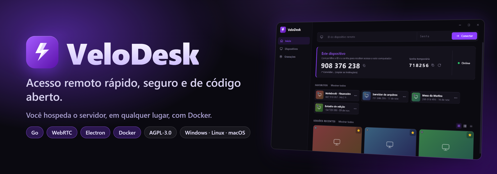

<br>

Controle de tela e teclado, arquivos, bate-papo, túneis TCP, impressão, gravação e muito mais, com o **seu** servidor, em qualquer lugar.

[](LICENSE)


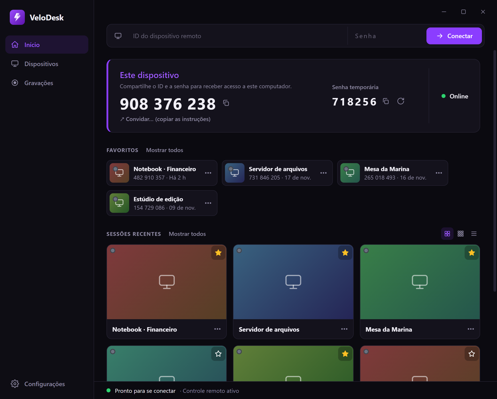

</div>

---

## Sumário

- [O que é](#o-que-é)
- [A história do projeto](#a-história-do-projeto)
- [Recursos](#recursos)
- [Telas](#telas)
- [Como funciona](#como-funciona)
- [Stack e termos técnicos](#stack-e-termos-técnicos)
- [Estrutura do repositório](#estrutura-do-repositório)
- [Servidor de sinalização (Docker)](#servidor-de-sinalização-docker)
- [Rodar o aplicativo](#rodar-o-aplicativo)
- [Gerar os instaladores](#gerar-os-instaladores)
- [Cliente com servidor fixo](#cliente-com-servidor-fixo-e-escondido)
- [Atualizações assinadas](#atualizações-assinadas)
- [Segurança](#segurança)
- [Plataformas e limitações](#plataformas-e-limitações)
- [Testes](#testes)
- [Configuração por variáveis de ambiente](#configuração-por-variáveis-de-ambiente)
- [Contribuir](#contribuir)
- [Licença](#licença)

## O que é

O VeloDesk é um programa de acesso remoto no estilo do AnyDesk, que **você mesmo hospeda**. São dois pedaços:

1. **O aplicativo** (Windows, Linux e macOS), que serve ao mesmo tempo para *acessar* outros computadores e para *ser acessado*.
2. **O servidor de sinalização**, um serviço minúsculo (um único binário; a imagem Docker tem cerca de 20 MB) que só apresenta os computadores uns aos outros.
   O vídeo, o teclado e os arquivos **não passam por ele**: vão direto entre os dois computadores, criptografados (WebRTC).

Não há conta, nuvem de terceiros nem telemetria. Você sobe o servidor onde quiser e aponta os aplicativos para ele.

## A história do projeto

O VeloDesk nasceu em **março de 2026** como um protótipo de acesso remoto: servidor de sinalização em **Node.js**, captura de tela em **Python** (com um esboço em **Rust**), interface em **Vite + Electron** e deploy em um serviço gratuito na nuvem.

**Cerca de 8 meses depois, o projeto foi retomado e refinado com a ajuda do [Claude](https://claude.com/product/claude-code)** (Claude Code, da Anthropic). O trabalho foi uma reescrita guiada, com revisão e decisões de produto minhas a cada etapa:

| | Protótipo (março) | Agora |
|---|---|---|
| **Núcleo** | Node.js + Python (processos separados) | **Go**: um único binário faz app, servidor e ferramentas |
| **Conexão** | Sinalização simples | **WebRTC** P2P (DTLS/SRTP) com autenticação por prova criptográfica |
| **Servidor** | Serviço gratuito na nuvem | **Docker** em qualquer lugar: imagem de ~20 MB, sem privilégios, HTTPS automático opcional |
| **Interface** | Vite + Electron | Janela com barra do sistema, tela de sessão com barra fixa, gerenciador de arquivos em dois painéis, escolha de monitor |
| **Segurança** | Senha enviada e comparada em texto puro pelo servidor | A senha **nunca trafega**: prova criptográfica (PBKDF2 + HMAC) amarrada à sessão DTLS, perfis de permissão no computador acessado, 2FA (TOTP), lista de IDs, atualizações assinadas (Ed25519) |
| **Qualidade** | Sem testes automatizados | Testes unitários em Go e **124 verificações ponta a ponta** com dois aplicativos reais |
| **Licença** | MIT | **AGPL-3.0** |

## Recursos

| Área | O que tem |
|---|---|
| **Controle remoto** | Tela, mouse e teclado com baixa latência, 60 quadros por segundo, qualidade que já começa alta, só o cursor do computador remoto, **escolha do monitor** quando o computador tem mais de um |
| **Tela de sessão** | Janela com a barra de título do sistema, aba com o nome do computador, barra de ferramentas fixa (informações e permissões, monitor, arquivos, bate-papo, ações, tela cheia) e a tela remota logo abaixo, sem nada cobrindo |
| **Quem é acessado** | Janela de aceite com permissões ajustáveis por pedido, marca d'água discreta no canto, janela da sessão compacta (não cobre a tela de quem controla) que expande com bate-papo, arquivos e permissões ao vivo, e botão **Desconectar** |
| **Acesso sem supervisão** | Senha fixa forte, entrada sem confirmação, acesso salvo revogável, senhas de curto prazo para reconectar após reinício |
| **Segurança** | Prova de senha por PBKDF2 + HMAC ligada à sessão DTLS, 2FA (TOTP), lista de IDs permitidos, bloqueio por tentativas, perfis de permissão |
| **Arquivos e texto** | Envio e recebimento com aceite, **gerenciador em dois painéis** (este dispositivo | remoto) com Upload e Baixar, área de transferência |
| **Rede** | Descoberta de computadores na rede local, Wake-On-LAN, túneis TCP, proxy com autenticação (inclusive NTLM no Windows), STUN/TURN configuráveis |
| **Outros** | Impressão remota, gravação de sessões, informações do sistema, reiniciar/bloquear/encerrar sessão (por permissão), miniaturas com o papel de parede de cada máquina |
| **Distribuição** | Instaladores `.exe`, `.deb`, `.rpm`, AppImage e macOS (`.zip`), atualização automática com builds **assinados** |

## Telas

<table>
  <tr>
    <td width="50%">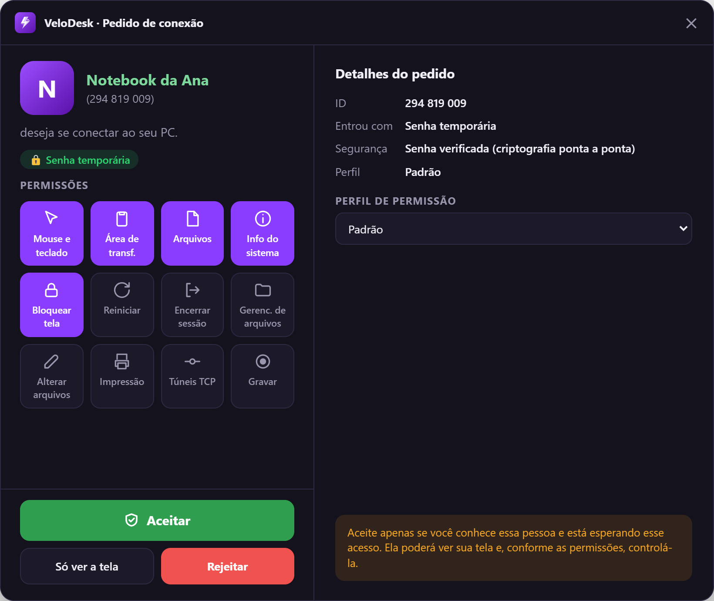<br><sub><b>Pedido de conexão</b>: quem aceita vê quem é, como entrou e escolhe as permissões.</sub></td>
    <td width="50%">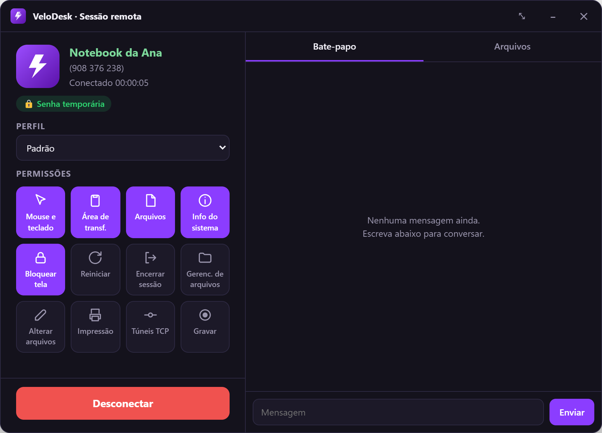<br><sub><b>Sessão ativa (expandida)</b>: permissões ao vivo, bate-papo, arquivos e <b>Desconectar</b>.</sub></td>
  </tr>
  <tr>
    <td>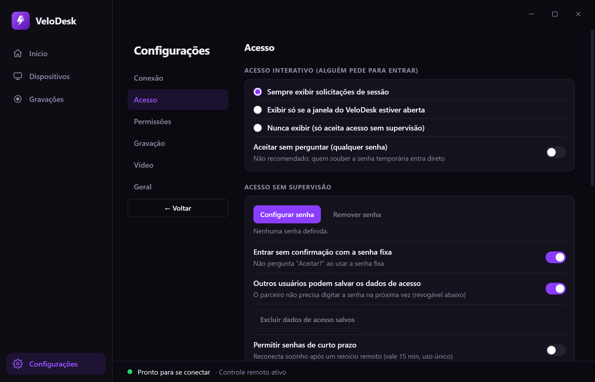<br><sub><b>Acesso</b>: confirmação, senha fixa, 2FA e lista de IDs.</sub></td>
    <td>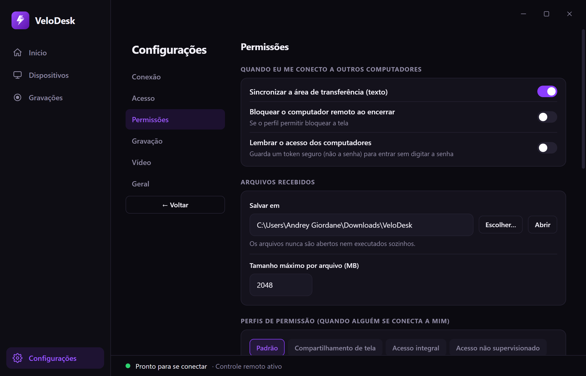<br><sub><b>Permissões</b>: perfis que valem no computador acessado.</sub></td>
  </tr>
  <tr>
    <td>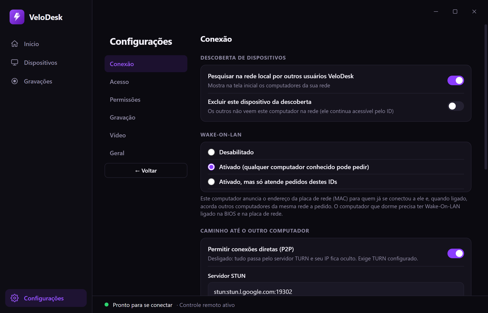<br><sub><b>Conexão</b>: descoberta, Wake-On-LAN, P2P, STUN/TURN e proxy.</sub></td>
    <td>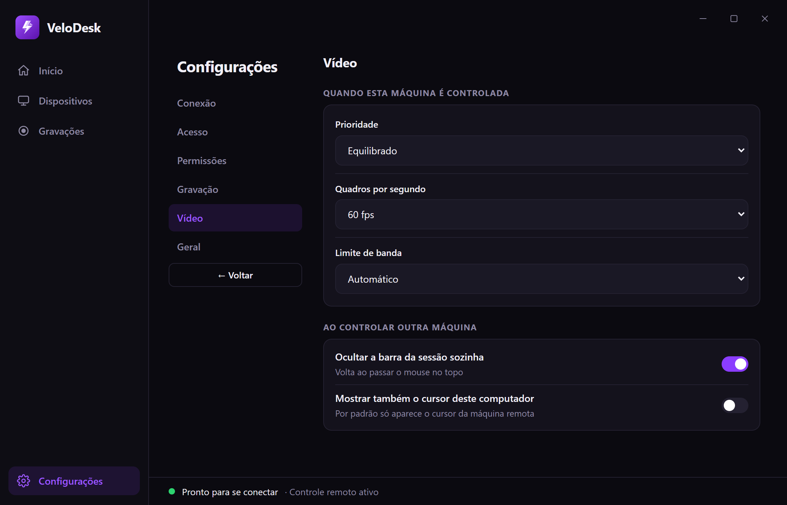<br><sub><b>Vídeo</b>: qualidade, quadros por segundo e limite de banda.</sub></td>
  </tr>
</table>

### Tela de sessão de quem controla

<table>
  <tr>
    <td width="50%">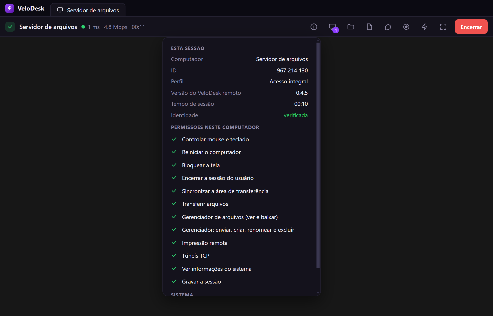<br><sub><b>Barra fixa e informações</b>: perfil, versão, tempo, permissões liberadas e escolha de monitor. A tela remota fica abaixo da barra.</sub></td>
    <td width="50%">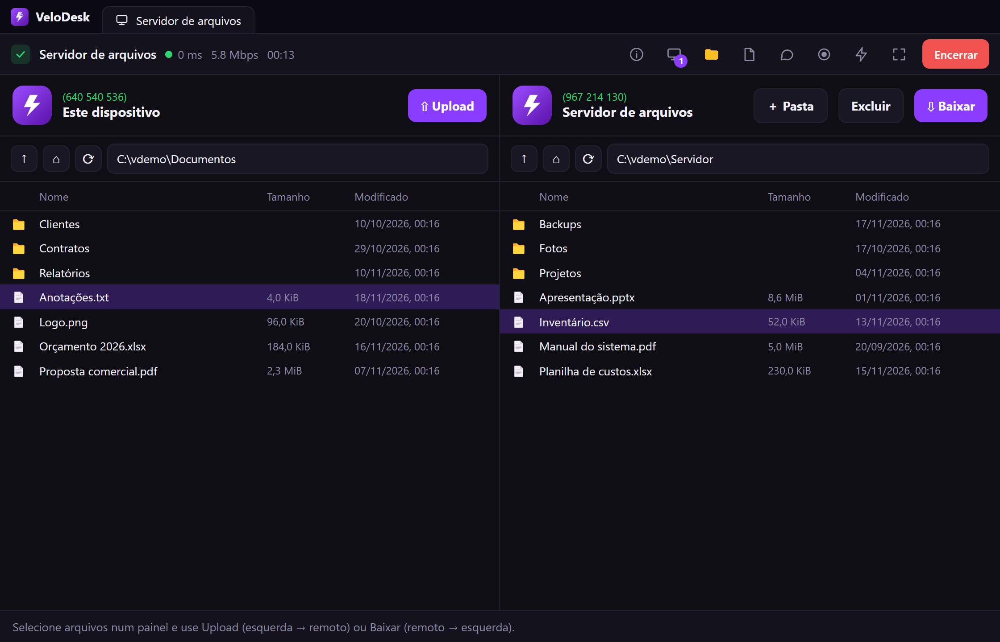<br><sub><b>Gerenciador de arquivos</b>: este dispositivo à esquerda, o remoto à direita, com <b>Upload</b> e <b>Baixar</b>.</sub></td>
  </tr>
</table>

> As imagens de sessão escondem o vídeo da tela remota e usam pastas e computadores fictícios.

### No computador acessado

Durante uma sessão, o computador acessado mostra uma marca discreta no canto da tela e uma **janela compacta** (nome, tempo e **Desconectar**) no canto inferior direito, para **não cobrir a tela de quem está controlando**. Ela expande sozinha quando chega uma mensagem ou um pedido de arquivo, ou pelo botão ⤢:

<div align="center">
  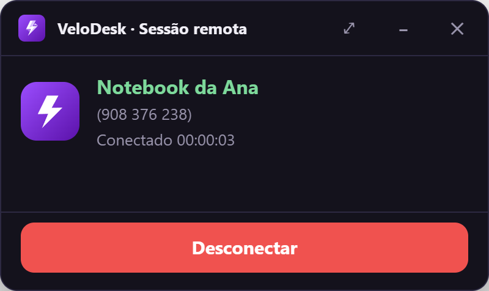
  &nbsp;&nbsp;
  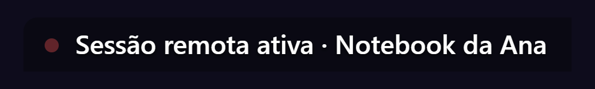
</div>

> As imagens usam um perfil de demonstração, com dispositivos e IDs fictícios.

## Como funciona

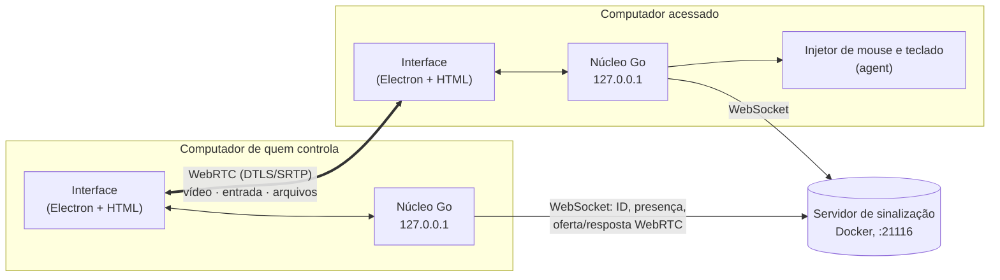

1. **Cada aplicativo** é uma casca [Electron](https://www.electronjs.org/) em volta de um **núcleo em Go**. O núcleo serve a interface em `127.0.0.1` (só a própria máquina alcança) e cuida de tudo que precisa de privilégio: injetar mouse e teclado, arquivos, impressão, túneis, Wake-On-LAN, proxy, segredos.
2. Ao abrir, o app se registra no **servidor** e recebe um **ID** de 9 dígitos. O servidor apenas encaminha mensagens e informa quem está online.
3. Para conectar, quem controla digita o ID e a senha. Os dois lados trocam as ofertas WebRTC **pelo servidor**, mas a senha **nunca trafega**: é feita uma prova de conhecimento (PBKDF2-SHA256 com 200 mil iterações + HMAC) amarrada à impressão digital DTLS da sessão, o que impede um servidor malicioso de se passar por um dos lados.
4. Com a sessão aberta, o computador acessado captura a tela e envia por **WebRTC**. Mouse e teclado voltam por canais de dados (um confiável e outro de baixa latência), e os arquivos têm canal próprio.
5. **Quem é acessado manda**: o perfil de permissões é aplicado **nele**, e pode ser alterado ao vivo. Se o controlador pedir algo que não foi permitido, o núcleo do computador acessado recusa.

Quando não há caminho direto (NAT rígido, rede corporativa), configure um servidor TURN em *Configurações › Conexão*. Por padrão só um STUN é usado, e ele é configurável.

## Stack e termos técnicos

<table>
<tr><td width="170"><b>Tempo real</b></td><td>WebRTC (ICE, STUN/TURN, DTLS-SRTP), canais de dados confiável e sem retransmissão (mouse), sinalização por WebSocket, ajuste de SDP (<code>x-google-start-bitrate</code>) para a imagem já abrir em resolução cheia, <code>replaceTrack</code> para trocar de monitor sem derrubar a sessão</td></tr>
<tr><td><b>Segurança</b></td><td>PBKDF2-SHA256 (200 mil iterações) + HMAC amarrado à impressão digital DTLS (anti-MITM), TOTP/2FA, perfis de permissão no host, limite de tentativas, segredos no cofre do sistema (<code>safeStorage</code>), atualização assinada com Ed25519, túneis restritos à rede local</td></tr>
<tr><td><b>Núcleo (Go)</b></td><td>Binário único, <code>go:embed</code> para a interface, injeção de entrada (<code>SendInput</code> no Windows, XTest no X11), coordenadas da área de trabalho virtual para vários monitores, Wake-On-LAN (pacote mágico), descoberta por broadcast UDP, proxy com NTLM/SSPI, túneis TCP sobre canais WebRTC</td></tr>
<tr><td><b>Interface</b></td><td>Electron 33 (<code>contextBridge</code>, IPC, janelas flutuantes, bandeja, instância única), HTML/CSS/JS sem etapa de build</td></tr>
<tr><td><b>Infraestrutura</b></td><td>Docker (imagem <i>distroless</i> não-root, sistema de arquivos somente leitura, <code>cap_drop: ALL</code>), Docker Compose, Caddy com TLS automático (Let's Encrypt)</td></tr>
<tr><td><b>Empacotamento</b></td><td>electron-builder: NSIS (.exe), .deb, .rpm, AppImage e macOS (.zip arm64 e x64), gerados em container; servidor fixo e escondido por variável de build</td></tr>
<tr><td><b>Qualidade</b></td><td>Testes unitários em Go (criptografia, TOTP, proxy, arquivos, túneis) e teste ponta a ponta que sobe dois Electron reais guiados pelo Chrome DevTools Protocol, em perfis isolados</td></tr>
<tr><td><b>Código aberto</b></td><td>AGPL-3.0-only, cabeçalhos SPDX em todos os arquivos de código</td></tr>
</table>

## Estrutura do repositório

```text
.
├── core/                         Núcleo em Go (um binário faz tudo)
│   ├── cmd/velodesk/
│   │   ├── main.go               Ponto de entrada: app | server | keygen | publish
│   │   ├── client.go             App: configuração, API local, servidor da interface
│   │   ├── server.go             Servidor de sinalização (WebSocket, presença, /healthz, /update/)
│   │   ├── security.go           Autenticação, 2FA, tokens, ACL, gravações, ações do sistema
│   │   ├── files.go · fsmgr.go   Transferência de arquivos e gerenciador de arquivos
│   │   ├── tunnel.go             Túneis TCP
│   │   ├── discovery*.go         Descoberta na rede local (UDP)
│   │   ├── wol.go                Wake-On-LAN
│   │   ├── proxy*.go             Proxy (inclui NTLM/SSPI no Windows)
│   │   ├── wallpaper*.go         Papel de parede para as miniaturas
│   │   ├── publish.go            keygen / publish de atualizações assinadas
│   │   └── ui/                   Interface embutida no binário (HTML/CSS/JS, sem build)
│   └── internal/
│       ├── agent/                Captura de entrada: injeta mouse e teclado (Windows, X11)
│       └── update/               Verificação de atualizações assinadas (Ed25519)
├── desktop/                      Casca Electron e empacotamento
│   ├── main.cjs · preload.cjs    Janelas, bandeja, marca d'água, janela da sessão, IPC
│   ├── scripts/                  build-core.cjs (compila o núcleo) · release.cjs (publica atualização)
│   └── tests/e2e.cjs             Teste ponta a ponta com dois aplicativos reais
├── deploy/                       Docker: HTTPS automático (Caddy)
├── Dockerfile                    Imagem do servidor (distroless, não-root)
├── docker-compose.yml            Servidor pronto para subir
└── docs/img/                     Capturas de tela deste README
```

## Servidor de sinalização (Docker)

O servidor roda em **qualquer lugar que tenha Docker**: um VPS, um Raspberry Pi, um servidor na empresa, seu PC. Ele consome poucos recursos (a configuração padrão limita a 128 MB de RAM).

### 1. Rede local, ou testes

```bash
git clone https://github.com/andreygiordane/VeloDesk.git && cd VeloDesk
docker compose up -d --build
curl http://localhost:21116/healthz        # responde: ok
```

Os aplicativos se conectam em `ws://IP_DO_SERVIDOR:21116`. Para trocar a porta, use `VELODESK_PORT=8080 docker compose up -d`.

### 2. Internet, com HTTPS automático

Aponte um domínio para o servidor, libere a porta **443/tcp** e suba junto com o Caddy, que obtém e renova o certificado (Let's Encrypt) sozinho:

```bash
DOMAIN=remoto.exemplo.com docker compose \
  -f docker-compose.yml -f deploy/docker-compose.tls.yml up -d --build
```

Os aplicativos usam `wss://remoto.exemplo.com`. Neste modo a porta 21116 **não** fica exposta: só o Caddy escuta na 443. Verificação: `https://remoto.exemplo.com/healthz` responde `ok`.

### 3. Atrás do seu próprio proxy (Nginx, Traefik, Cloudflare Tunnel…)

Rode apenas o servidor e encaminhe o tráfego (inclusive WebSocket) para a porta `21116`. Exemplo de Nginx:

```nginx
location / {
    proxy_pass http://127.0.0.1:21116;
    proxy_http_version 1.1;
    proxy_set_header Upgrade $http_upgrade;
    proxy_set_header Connection "upgrade";
    proxy_read_timeout 1h;
}
```

### Sem Docker

```bash
cd core && go build -o velodesk ./cmd/velodesk
./velodesk server -addr :21116 -updates ./updates
```

### Endurecimento já incluído

O container roda sem privilégios (`cap_drop: ALL`, `no-new-privileges`), com sistema de arquivos somente leitura, limite de memória e de processos, e imagem *distroless* não-root.
Atualizar o servidor: `git pull && docker compose up -d --build`. Logs: `docker compose logs -f`.

## Rodar o aplicativo

Requisitos: **Node.js 22+** e **Go 1.27+**.

```bash
cd desktop
npm install
node scripts/build-core.cjs      # compila o núcleo para este sistema
npm start
```

Na primeira abertura o app pede o endereço do servidor (`ws://…` ou `wss://…`).
Para já abrir apontando para o seu, defina `VELODESK_DEFAULT_SERVER=wss://remoto.exemplo.com` antes de `npm start`.

## Gerar os instaladores

```bash
cd desktop
npm run dist:win        # Windows (.exe, NSIS)
npm run dist:linux      # AppImage, .deb e .rpm
npm run dist:mac        # macOS (.zip, arm64 e x64)
```

- **Linux e macOS** são mais fáceis de gerar dentro do container `electronuserland/builder`, a partir de uma cópia da pasta `desktop` sem `node_modules`. O pacote macOS precisa ser gerado uma vez por arquitetura (`--x64` e `--arm64`).
- **Windows**: se o electron-builder reclamar de `Cannot create symbolic link`, ative o *Modo de desenvolvedor* do Windows.
- Os instaladores **não são assinados**: o Windows (SmartScreen) e o macOS (Gatekeeper) pedem uma confirmação na primeira abertura.
- Cada build deve ter uma versão nova em `desktop/package.json` (os nomes dos arquivos carregam a versão).

## Cliente com servidor fixo e escondido

Para distribuir para clientes ou equipe sem que ninguém precise (ou possa) mexer no servidor, gere o instalador assim:

```bash
VELODESK_DEFAULT_SERVER=wss://remoto.exemplo.com VELODESK_LOCK_SERVER=1 npm run dist:win
```

Com `VELODESK_LOCK_SERVER=1` o app sempre usa esse servidor, ignora qualquer outro salvo antes, **não mostra o endereço** em lugar nenhum e remove o campo *Servidor* das Configurações. Sem a variável, o campo continua disponível.

## Atualizações assinadas

O app só aceita atualizações cujo build esteja **assinado com Ed25519**; a chave pública fica embutida em `core/internal/update/update.pub`. Para publicar as suas, **gere o seu próprio par de chaves** e troque a pública (o repositório traz a do projeto original):

```bash
cd core
go run ./cmd/velodesk keygen -out ~/.config/velodesk-publish   # cria update.key (PRIVADA, nunca versione) e update.pub
cp ~/.config/velodesk-publish/update.pub internal/update/update.pub

cd ../desktop
npm run release -- 0.5.0 "o que mudou"     # compila, assina e grava em ~/velodesk-updates
# o servidor distribui essa pasta (-updates) e avisa os clientes sozinho
```

## Segurança

- A senha **nunca** trafega: a conexão usa prova criptográfica (PBKDF2 + HMAC), ligada à identidade DTLS da sessão.
- Perfis de permissão aplicados **no computador acessado** (mouse e teclado, reiniciar, bloquear, encerrar sessão, área de transferência, arquivos, gerenciador, alteração de arquivos, impressão, túneis, gravação).
- 2FA (TOTP), lista de IDs permitidos, senha fixa forte, acesso salvo revogável, senhas de curto prazo e bloqueio por tentativas.
- Túneis só alcançam a rede local do computador acessado, e o gerenciador de arquivos protege as pastas do sistema.
- Segredos guardados no cofre do sistema (via Electron `safeStorage`); a interface só é servida em `127.0.0.1`.
- Atualização automática apenas com builds assinados (Ed25519).
- Quem é acessado sempre vê: marca d'água durante a sessão, janela com quem está conectado e botão para desconectar.

Encontrou uma falha de segurança? Abra um *security advisory* privado na aba **Security** do repositório, em vez de uma issue pública.

## Plataformas e limitações

| Plataforma | Controlar outros | Ser controlado | Observações |
|---|:-:|:-:|---|
| Windows 10/11 | ✅ | ✅ | NTLM do Windows no proxy, impressão remota, túneis, tudo acima |
| Linux (X11) | ✅ | ✅ | **Wayland não é suportado** para ser controlado |
| macOS | ✅ | ❌ ainda | Falta o injetor de teclado e mouse; app não assinado |

Outras limitações conhecidas:

- O cursor do computador remoto vem dentro do vídeo (o Electron não permite capturar a tela sem ele), então há o atraso do vídeo ao mover o mouse. Uma captura nativa no núcleo é o próximo passo natural.
- Sem TURN configurado, redes com NAT simétrico podem não conseguir o caminho direto.
- A escolha de monitor foi testada no Windows com dois monitores; o apontamento do mouse para o monitor escolhido também existe para Linux (X11), mas ainda não foi testado em hardware com mais de um monitor.
- Os pacotes Linux e macOS são gerados e inspecionados, mas os testes ponta a ponta automatizados rodam no Windows.

## Testes

```bash
# Núcleo: TOTP, criptografia, autenticação, proxy (inclui NTLM real do Windows), arquivos, túneis, Wake-On-LAN…
cd core && go test ./...

# Ponta a ponta (Windows): sobe dois aplicativos reais e os guia pelo DevTools Protocol
docker compose up -d                                     # servidor local na raiz do repositório
cd desktop && npm install && node scripts/build-core.cjs win
VELODESK_DEFAULT_SERVER=ws://127.0.0.1:21116 node tests/e2e.cjs     # ONLY=T1,T7 filtra os grupos
```

O teste ponta a ponta cobre autenticação, permissões, arquivos, gerenciador, túneis, impressão (simulada), gravação, Wake-On-LAN, versões, janelas de aceite e sessão, e a qualidade do vídeo logo no início. Ele usa perfis temporários isolados e **não** reinicia nem bloqueia a máquina de verdade.

## Configuração por variáveis de ambiente

| Variável | Para quê |
|---|---|
| `VELODESK_DEFAULT_SERVER` | Servidor padrão do app (`ws://…` ou `wss://…`) |
| `VELODESK_LOCK_SERVER=1` | Trava o servidor e esconde o endereço (exige `VELODESK_DEFAULT_SERVER`) |
| `VELODESK_PORT` | Porta local da interface (padrão 21120) · no Docker, porta publicada do servidor |
| `VELODESK_UPDATE_KEY` · `VELODESK_UPDATES_DIR` | Chave de assinatura e pasta de saída do `npm run release` |
| `VELODESK_DISC_PORT` · `VELODESK_WOL_PORT` | Portas UDP de descoberta (padrão 21117) e de Wake-On-LAN (padrão 9 e 7), úteis em testes |
| `VELODESK_PRINT_DRYRUN=1` | Testa a impressão remota sem imprimir |

## Contribuir

Issues e *pull requests* são bem-vindos. Antes de abrir um PR:

1. Rode `cd core && gofmt -l . && go vet ./... && go test ./...`.
2. Mudanças na interface ficam em `core/cmd/velodesk/ui/` (HTML único, sem etapa de build); como ela é embutida no binário, recompile o núcleo para vê-las (`node scripts/build-core.cjs`).
3. Se mexer em segurança, permissões ou conexão, rode também o teste ponta a ponta.
4. Arquivos novos de código levam o cabeçalho `SPDX-License-Identifier: AGPL-3.0-only`.

## Licença

O VeloDesk é software livre, licenciado sob a **[GNU Affero General Public License v3.0](LICENSE)** (AGPL-3.0-only).

Em resumo: você pode usar, estudar, modificar e distribuir. Se distribuir uma versão modificada **ou oferecê-la como serviço pela rede** (por exemplo, rodar um servidor VeloDesk alterado para outras pessoas), precisa disponibilizar o código-fonte dessas modificações sob a mesma licença.
